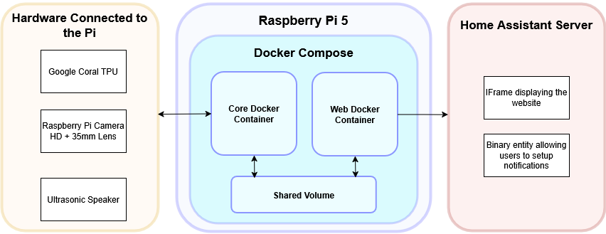
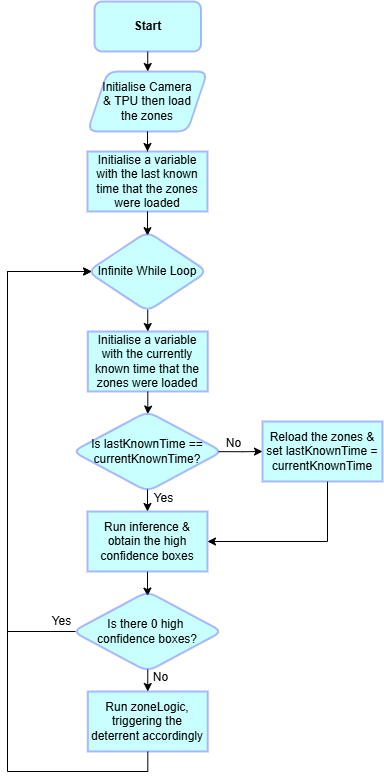
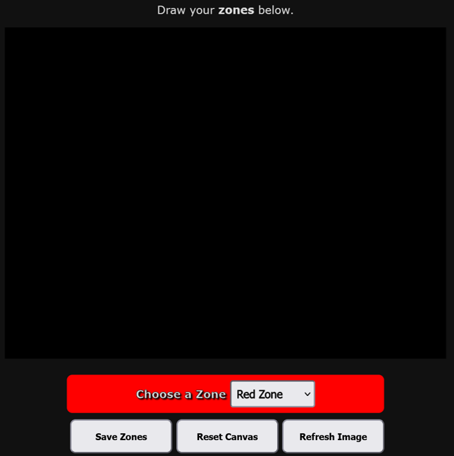
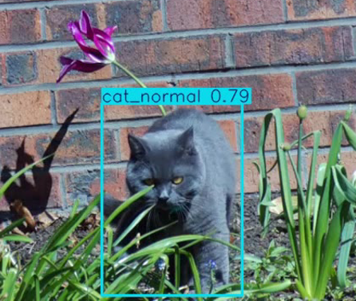

# Cattainer

**An autonomous, self-hosted AI cat monitoring and predictive escape deterrence system powered by Raspberry Pi 5, Google Coral Edge TPU, and Docker.**



## Overview

Road traffic accidents are the leading cause of death for domestic cats up to the age of eight, forcing many owners to choose between keeping their pets strictly indoors or installing intrusive physical garden barriers like fence rollers, netting, and spikes. Meanwhile, commercial smart camera systems rely on closed-source cloud processing and paid monthly subscriptions, creating privacy concerns when monitoring private gardens.

**Cattainer** provides a 100% local, privacy-first computer vision monitoring system that acts as a predictive virtual boundary. Instead of reacting *after* a cat has already escaped, Cattainer runs a custom-trained **YOLOv8n** object detection model on a **Google Coral TPU** to track cats in real time (~33 FPS) and recognize pre-jump postures (`cat_jumping`) before the cat leaves the ground. Users can draw custom polygon zones over their garden via an intuitive web interface and receive sub-second notifications and automation triggers in **Home Assistant**.

---

## Key Features

* **Predictive Edge AI Inference:** Runs an 8-bit quantized `.tflite` YOLOv8n model on a Google Coral Edge TPU, achieving ~33 FPS average throughput (~21 ms raw inference time) with zero cloud dependencies.
* **Behavioural Classification:** Differentiates between standard movement (`cat_normal`) and pre-jump posture (`cat_jumping`) to enable preventative deterrence.
* **Interactive Polygon Zone Mapping:** Hosts a dark-themed Flask/Gunicorn web application (`port 5000`) where users draw custom polygons over a live snapshot of their garden:
  * **🟥 Red Zones (Strictly Forbidden):** Triggers the deterrent/notification immediately if any cat (`cat_normal` or `cat_jumping`) enters the zone with $\ge 60\%$ confidence.
  * **🟨 Amber Zones (No-Jump Warning):** Allows the cat to roam normally, triggering *only* if the cat is inside the zone **and** exhibits pre-jump behaviour (`cat_jumping` at $\ge 60\%$ confidence).
* **Hot-Reloading Configuration:** Monitors modification timestamps on `zones.json` and dynamically reloads newly saved polygon boundaries without interrupting the live AI inference loop.
* **Hardened Multi-Container Architecture:** Split into isolated `cattainer-core` and `cattainer-web` Docker containers orchestrated via `docker-compose.yml`, following the Principle of Least Privilege with non-root `app` users and explicit Linux device/cgroup mappings.
* **Home Assistant Integration:** Pairs with [cattainer-integration](https://github.com/ClemF4/cattainer-integration) to embed the zone editor directly into the Home Assistant sidebar and push instant state updates via local HTTP webhooks.

---

## Repository Structure

```text
Cattainer/
├── assets/
│   ├── core-flowchart.png      # Core detection & deterrent logic flow diagram
│   ├── inference-demo.png      # Real-time YOLOv8n bounding box detection frames
│   ├── system-diagram.png      # Full hardware & Docker system block diagram
│   └── web-gui.png             # Zone Selection Web UI screenshot
├── cattainer-core/             # Core computer vision, TPU inference & zone logic container
├── cattainer-web/              # Flask/Gunicorn web server & HTML5 Canvas UI container
├── .gitignore
├── docker-compose.yml          # Multi-container orchestration & hardware passthrough
├── LICENSE
└── README.md
```

---

## Hardware Requirements

| Component | Specification / Model | Purpose & Notes |
| :--- | :--- | :--- |
| **Single-Board Computer** | Raspberry Pi 5 (8GB RAM) | Hosts the 64-bit OS and runs the multi-container Docker stack without swap bottlenecks. |
| **AI Accelerator** | Google Coral USB Accelerator (Edge TPU) | Offloads quantized `.tflite` inference, boosting speed ~15x over the Pi 5 CPU. |
| **Camera** | Raspberry Pi HQ Camera (Sony IMX477, 12.3MP) | Connects via the CSI ribbon port to route directly to the ISP, bypassing USB bus saturation. |
| **Lens** | Arducam 35mm C-Mount Lens (or C/CS lens suited to garden FOV) | 35mm focal length is calculated for a 1.8m wide target scene at a 10m working distance. |
| **Storage** | 64GB+ M.2 NVMe SSD + USB 3.0 to M.2 Adapter | Prevents premature NAND flash degradation/corruption caused by continuous logging and frame writes on microSD cards. |
| **Power Supply** | Official Raspberry Pi 27W USB-C Power Supply | Sustains peak system load (~23.5W across Pi 5, Coral TPU, NVMe SSD, and HQ Camera) and prevents TPU brownouts. |

---

## System Architecture

<p align="center">
  
</p>

Cattainer uses a decoupled two-container architecture orchestrated by `docker-compose.yml` and linked through a shared persistent volume:

1. **`cattainer-web` Container (`app.py` & `index.html`):**
   * Runs a lightweight Debian + Python image serving a **Flask** backend via **Gunicorn** bound to `0.0.0.0:5000`.
   * Renders the HTML5 Canvas UI styled to match Home Assistant's dark interface (`rgb(17, 17, 17)`) and sets custom HTTP headers to allow iFrame embedding.
   * Features automatic border-snapping and a 15-pixel polygon auto-closure threshold (`ClickX - FirstX < 15`, `ClickY - FirstY < 15`).
   * Exposes three routes:
     * `GET /` — Renders the interactive zone selection page.
     * `POST /savedZones` — Sanitizes incoming polygon JSON payloads (enforcing $<10$ zones and $<50$ points per zone for DoS protection) and writes them to `zones.json`.
     * `POST /triggerSnapshot` — Creates a `trigger_snapshot` flag file in the shared volume to request a fresh camera frame from the Core container.

2. **`cattainer-core` Container (`core.py`):**
   * Built on Debian Bookworm with Raspberry Pi repository packages (`picamera2`), OpenCV, Ultralytics, and the standard Edge TPU runtime.
   * **Hardware Verification & Warmup:** Initializes the camera at `640x480` (`RGB888`) and runs two warmup passes on a zeroed `640x480` `uint8` dummy frame. Verifies that the second inference completes in $<0.5\text{s}$ to confirm the Coral TPU is active rather than falling back to the CPU.
   * **Synchronous Detection & Zone Loop:**
     * Checks if `trigger_snapshot` is present; if so, writes the current frame to `/static/background.png` and deletes the flag.
     * Runs YOLOv8n inference (`320x320`) and extracts bounding box center coordinates (`xywh`) and class labels (`cat_normal` or `cat_jumping`) for all detections with $>60\%$ confidence.
     * Evaluates each target against pre-formatted `np.int32` polygon arrays using OpenCV's `cv2.pointPolygonTest`.
     * Fires an HTTP POST webhook (`{"cat_detected": true/false}`) to Home Assistant upon zone breaches and logs events via a `RotatingFileHandler` (`cattainer.log`, capped at 5MB with 2 backups).

---

## Installation

### Prerequisites
* Raspberry Pi 5 running **Raspberry Pi OS (64-bit, Debian 12 Bookworm)**.
* Pi HQ Camera connected via the CSI ribbon slot and Google Coral USB Accelerator connected to a USB 3.0 port.

### Quick Start
Run the following commands on your Raspberry Pi terminal to install Docker, configure user permissions, clone Cattainer, and launch the containers:

```bash
# 1. Install Docker
curl -fsSL [https://get.docker.com](https://get.docker.com) -o get-docker.sh
sudo sh get-docker.sh

# 2. Add your user to the Docker group (avoids needing sudo)
sudo usermod -aG docker $USER
newgrp docker

# 3. Clone the repository
git clone [https://github.com/ClemF4/Cattainer.git](https://github.com/ClemF4/Cattainer.git)
cd Cattainer

# 4. Build and start the Core and Web containers in detached mode
docker compose up -d
```

*(Note: Ensure your Home Assistant IP address is configured in the deterrent webhook script before building if you are using Home Assistant notifications.)*

---

## Usage & Zone Configuration

<p align="center">
  
</p>

1. **Access the Web UI:** Open a browser on your local network and navigate to `http://<RASPBERRY_PI_IP>:5000` (or open the **Cattainer** panel directly inside Home Assistant).
2. **Capture a Garden Snapshot:** Click **Refresh Image**. The web server signals the Core container to grab a live frame from the Pi HQ Camera and refreshes the canvas after 1 second.
3. **Select a Zone Type:** Use the **Choose a Zone** dropdown menu to select either **Red Zone** (strictly forbidden) or **Amber Zone** (trigger only on `cat_jumping`).
4. **Draw Polygons:** Click on the canvas to place vertices around flowerbeds, fences, or garden boundaries. Clicks near the edge automatically snap to the canvas border to eliminate dead zones. Click within `15px` of your starting point to close and fill the polygon.
5. **Save Configuration:** Click **Save Zones**. The button will flash green for 0.5 seconds to confirm `zones.json` was saved and hot-reloaded by the Core container. Use **Reset Canvas** at any time to clear existing polygons and start over.

---

## Performance & Testing

<p align="center">
  
</p>

* **Hardware Benchmarks (Raspberry Pi 5 + Coral USB TPU running YOLOv8n @ 320x320):**
  * **Average Frame Rate:** 33 FPS (consistently 31–35 FPS, exceeding the 30 FPS real-time specification required to track a cat moving at up to 13.4 m/s).
  * **CPU Utilization:** 24% peak at startup, ~12% baseline during continuous inference.
  * **Thermal Performance:** Plateaus at $60^{\circ}\text{C}$ (well below the Pi 5's $85^{\circ}\text{C}$ thermal throttling limit).
* **Zone Logic & Webhook Validation:** Passed 16/16 test matrix scenarios across full/half Red and Amber zones with sub-second end-to-end webhook latency.
* **Current Model Limitations:** The included `model_edgetpu.tflite` weights were trained on a proof-of-concept dataset of 468 annotated images of a single feline subject. While it achieves high precision when the cat is unobstructed (`mAP50` of 0.995 on validation sets), it is sensitive to background foliage false positives and partial occlusion false negatives. Position the camera with a clear, unobstructed line of sight to the monitored boundary.

---

## Potential Future Upgrades

* **Asynchronous Multi-Threaded Pipeline:** Transition `core.py` from a synchronous loop to a 3-thread Producer/Consumer architecture (Frame Capture $\rightarrow$ Queue 1 $\rightarrow$ TPU Inference $\rightarrow$ Queue 2 $\rightarrow$ Zone Logic & Deterrent) with a drop-oldest frame policy.
* **Generalised Model & Human-in-the-Loop (HITL):** Expand training across diverse cat breeds, coats, and gardens, incorporating user verification prompts for low-confidence (<70%) detections.
* **Physical Deterrent Modules:** Integrate GPIO/wireless hardware deterrents including directional ultrasonic speakers, solenoid-controlled water sprinklers, pneumatic air bursts, and motorized fence rollers.
* **Hardware Abstraction & Custom PCB:** Add a camera/accelerator Hardware Abstraction Layer (supporting USB webcams and non-Pi architectures), design a compact Raspberry Pi Compute Module 5 (CM5) carrier board with dual M.2 slots (NVMe + PCIe Coral TPU), and print a weatherproof PETG outdoor enclosure.
* **Cybersecurity Hardening:** Enforce HTTPS/TLS on Gunicorn and add dynamic Home Assistant LAN discovery.

---

## Acknowledgements

Developed by **Clement Faure** as a Final Year Individual Project Thesis (*EEEE4008: Development of a Cat Monitoring System*) for the degree of Master of Engineering (MEng) in the Department of Electrical and Electronic Engineering at the **University of Nottingham** (Supervised by Dr. Richard Smith).